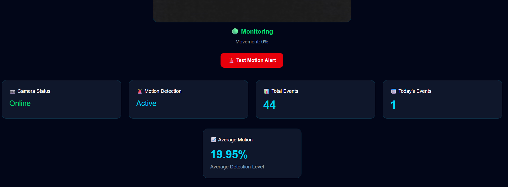

# 🛡️ MotionGuard AI

**A real-time, browser-based motion detection and monitoring system** built with the MERN stack. MotionGuard AI uses computer-vision frame differencing on a live webcam feed to detect movement, logs every event to a database, and visualizes activity on a live analytics dashboard.

🔗 **Live Demo:** [motionguard-ai.vercel.app](https://motionguard-ai.vercel.app)

---

## ✨ Features

- 📷 **Live webcam monitoring** directly in the browser (no installation, no plugins)
- 🧠 **Computer-vision motion detection** using frame-by-frame pixel differencing (`pixelmatch`)
- 🚨 **Instant on-screen status**: switches between *Monitoring* and *Motion Detected* in real time
- 💾 **Automatic event logging**: motion events are saved to MongoDB with the detected motion percentage and timestamp (rate-limited to avoid duplicate spam)
- 📊 **Analytics dashboard**: total events, today's events, average motion level, and a motion-activity line chart
- 🕒 **Motion history table** with date and motion percentage for every event
- 🔐 **User authentication**: register/login with hashed passwords (bcrypt) and JWT tokens
- 🎨 **Modern responsive UI** with Tailwind CSS and Framer Motion animations

---

## 🧠 How Motion Detection Works

1. The webcam is sampled every **2 seconds** (`react-webcam`).
2. Each new frame and the previous frame are drawn onto a **320×240 canvas**.
3. The two frames are compared pixel-by-pixel with **`pixelmatch`** (color-difference threshold `0.1`).
4. The number of changed pixels is converted into a **motion percentage**:

   ```
   motion % = (changed pixels / total pixels) × 100
   ```

5. If motion exceeds the trigger threshold (**2%**), the UI flags *Motion Detected* and the event is sent to the backend (saved at most once every 5 seconds).

> This is a classical computer-vision approach (frame differencing) that runs entirely in the browser, so no video is streamed to the server. Only the motion percentage and user ID are stored.

---

## 🧰 Tech Stack

| Layer | Technologies |
|-------|--------------|
| **Frontend** | React 19, Vite, React Router, Tailwind CSS 4, Framer Motion, Recharts, Axios, react-webcam, pixelmatch, Lucide / React Icons |
| **Backend** | Node.js, Express 5, Mongoose, JSON Web Tokens, bcryptjs, Multer, CORS, dotenv |
| **Database** | MongoDB (MongoDB Atlas compatible) |
| **Deployment** | Vercel (frontend) |

---

## 📁 Project Structure

```
motionguard-ai/
├── client/                 # React + Vite frontend
│   └── src/
│       ├── components/
│       │   └── Camera.jsx  # Webcam capture + motion detection logic
│       └── pages/
│           ├── Login.jsx
│           ├── Register.jsx
│           ├── Dashboard.jsx   # Live camera, stats, chart, history
│           └── History.jsx
├── server/                 # Node.js + Express backend
│   ├── models/             # Mongoose models (User, MotionEvent)
│   ├── routes/
│   │   ├── authRoutes.js     # /api/auth
│   │   ├── motionRoutes.js   # /api/motion
│   │   └── historyRoutes.js  # /api/history
│   └── server.js
└── .gitignore
```

---

## 🚀 Getting Started

### Prerequisites

- [Node.js](https://nodejs.org/) v18 or higher
- A [MongoDB](https://www.mongodb.com/) database (local or MongoDB Atlas)
- A device with a webcam

### 1. Clone the repository

```bash
git clone https://github.com/amnashoaib2510-cloud/motionguard-ai.git
cd motionguard-ai
```

### 2. Set up the backend

```bash
cd server
npm install
```

Create a `.env` file inside `server/`:

```env
PORT=5000
MONGO_URI=your_mongodb_connection_string
JWT_SECRET=your_long_random_secret
```

Start the server:

```bash
npm run dev     # development (nodemon)
# or
npm start       # production
```

### 3. Set up the frontend

Open a new terminal:

```bash
cd client
npm install
```

Create a `.env` file inside `client/`:

```env
VITE_API_URL=http://localhost:5000
```

Start the app:

```bash
npm run dev
```

Open the URL shown in the terminal (usually `http://localhost:5173`), register an account, log in, and allow camera access.

---

## 🔌 API Reference

| Method | Endpoint | Description |
|--------|----------|-------------|
| `POST` | `/api/auth/register` | Create a new account (`name`, `email`, `password`) |
| `POST` | `/api/auth/login` | Log in; returns a JWT (valid 7 days) and user info |
| `POST` | `/api/motion/save` | Save a motion event (`user`, `percentage`) |
| `GET`  | `/api/history` | Fetch all motion events, newest first |

---

## 🗺️ Roadmap

- [ ] Deep-learning based detection (e.g., YOLO / MobileNet-SSD) to classify *what* moved (person, animal, object)
- [ ] Snapshot capture and image upload when motion is detected
- [ ] Per-user history and protected routes using JWT middleware
- [ ] Email / push notifications for motion alerts
- [ ] Adjustable sensitivity and detection zones
- [ ] Export history as CSV / PDF reports

---

## 📸 Screenshots

> Add screenshots here (login page, dashboard, motion history).

```

```

---

## 👩‍💻 Author

**Amna Shoaib**
BS Information Technology, MNS University of Agriculture, Multan, Pakistan
Research interests: Artificial Intelligence, Computer Vision, Deep Learning

- GitHub: [@amnashoaib2510-cloud](https://github.com/amnashoaib2510-cloud)

---

## 📄 License

This project is licensed under the [MIT License](LICENSE).
